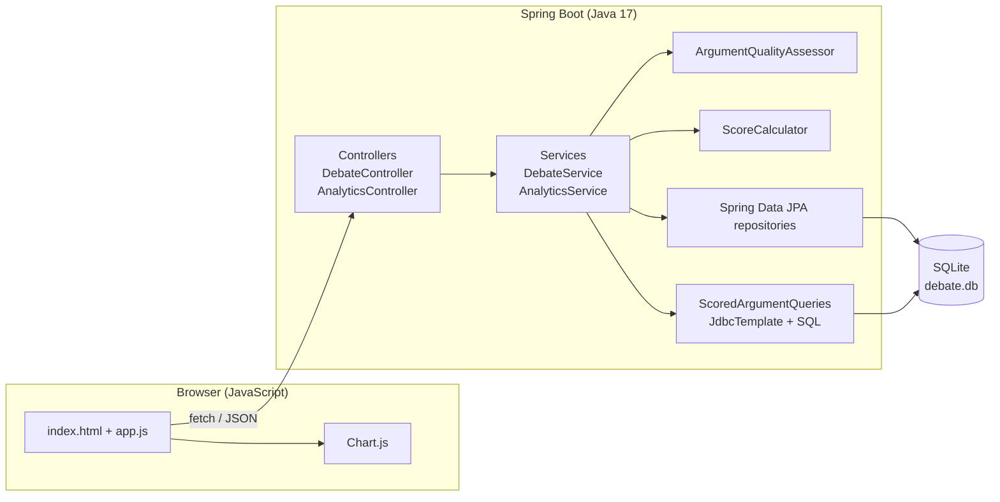
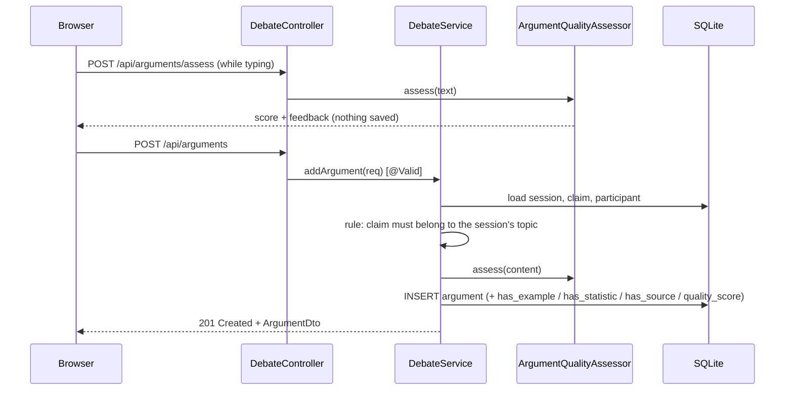
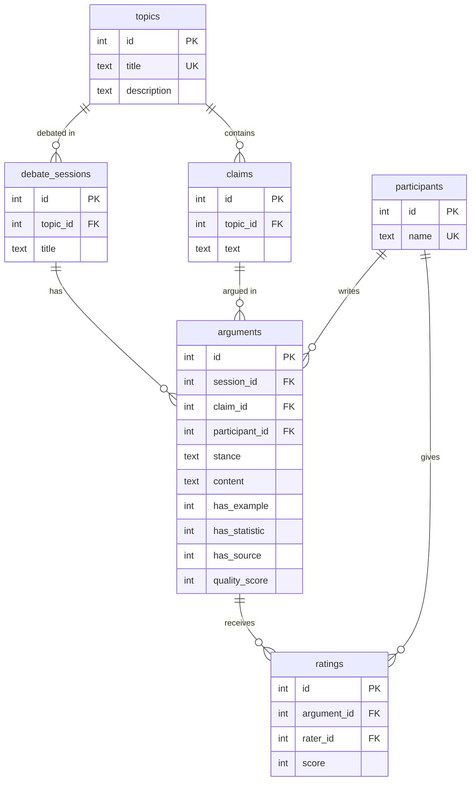

# Debate Arena Analysis System

A **client-server** application for running structured debates and analyzing them. It has a **Java (Spring Boot)**
backend, a **JavaScript** frontend and an **SQL** database.

Participants post arguments **for (PRO)** or **against (CON)** claims across many debate sessions and rate each
other's arguments. The system then:

- runs a **technical assessment** on every argument: does it include an example for the claim, and does every
  statistic have a source?
- calculates the **strength of each claim** by analyzing ratings across all debate sessions on the topic
- generates **participant statistics and rankings** for each claim, based on the ratings of their arguments
- stores everything in a relational **SQL database** and **visualizes** the results in the browser

> Academic project, Ariel University (2024).

---

## Features

| Area | What is implemented |
|---|---|
| Debate management | Participants, topics, claims, debate sessions, arguments, 1-5 peer ratings |
| Argument assessment | Rule-based detection of examples, statistics and sources; quality score 0-100 with improvement tips; live preview while typing |
| Claim strength | Weighted PRO vs CON balance, overall and per session, with a verdict: STRONG / CONTESTED / WEAK |
| Rankings | Participant ranking per claim plus an overall leaderboard (competition ranking with ties) |
| Database | SQLite schema with FKs, CHECK and UNIQUE constraints, indexes, a trigger and a view |
| API | REST + JSON, Bean Validation, consistent error format (404 / 409 / 400) |
| Frontend | Vanilla JS single-page app with Chart.js charts and dark-mode support |
| Quality | Unit tests (JUnit 5 + AssertJ), full-stack integration tests (MockMvc + real SQLite), GitHub Actions CI, Dockerfile |

---

## Architecture



The project uses a **layered architecture**:

- **Controller** handles HTTP and validation.
- **Service** holds business rules and transactions.
- **Repository** handles persistence.
- **`analysis/`** contains pure algorithms with no Spring or DB dependencies, so they are easy to unit test.

### Flow: submitting an argument



---

## Algorithms

### 1. Argument quality assessment ([ArgumentQualityAssessor](src/main/java/com/debatearena/analysis/ArgumentQualityAssessor.java))

Regex-based detection:

| Signal | Detected by |
|---|---|
| Example | "for example", "for instance", "e.g.", "such as", ... |
| Statistic | `13%`, `40 percent`, `2 million`, `3 out of 10` |
| Source | URLs, "according to", "study", "survey", "report", "research", `[1]` |

| Rule | Points |
|---|---|
| Base | 40 |
| Contains an example | +20 |
| Cites a source | +20 |
| Statistic **with** a source | +15 |
| Statistic **without** a source | **−15** |
| At least 15 words | +5 (otherwise −10) |

The score is clamped to 0-100, and each missing element produces a written improvement tip.

### 2. Combined argument score ([ScoreCalculator](src/main/java/com/debatearena/analysis/ScoreCalculator.java))

```
ratingPercent = (avgRating − 1) / 4 × 100        # 1..5 → 0..100
combined      = 0.7 × ratingPercent + 0.3 × qualityScore
```

An argument with no ratings yet gets a neutral 3/5, so it is neither rewarded nor penalized.

### 3. Claim strength

```
strength = 100 × Σ combined(PRO) / (Σ combined(PRO) + Σ combined(CON))
```

- 100 means only strong supporting arguments, 0 means only strong opposing ones, and 50 means balanced.
- It is calculated **across all sessions** and also **per session**, so you can see how support for a claim
  changes over time.
- Verdict: ≥ 60 → **STRONG**, ≤ 40 → **WEAK**, otherwise **CONTESTED**.

### 4. Participant ranking (per claim and overall)

- Score = the average combined score of the participant's arguments.
- The average rating is **weighted by the number of ratings**, so every individual rating counts once.
- Competition ranking: equal scores share a rank (1, 2, 2, 4).

---

## Database design



Highlights (see [schema.sql](src/main/resources/db/schema.sql)):

- **CHECK** constraints: `stance IN ('PRO','CON')`, `score BETWEEN 1 AND 5`, `quality_score BETWEEN 0 AND 100`.
- **UNIQUE (argument_id, rater_id)**: each participant can rate an argument only once.
- **Trigger `trg_ratings_no_self_rating`**: the database itself blocks people from rating their own arguments. The
  service checks this too and returns a clear message.
- **View `argument_scores`**: the average rating and rating count for each argument, used by the analytics SQL.
- Hibernate does **not** generate the schema (`ddl-auto=none`). The schema lives in explicit, version-controlled
  SQL.

---

## REST API

| Method | Endpoint | Description |
|---|---|---|
| GET / POST | `/api/participants` | List / create participants |
| GET / POST | `/api/topics` | List / create topics (with their claims) |
| GET | `/api/topics/{id}` | Get one topic |
| POST | `/api/topics/{id}/claims` | Add a claim to a topic |
| GET / POST | `/api/sessions[?topicId=]` | List / create debate sessions |
| GET | `/api/sessions/{id}` | Session with its arguments, quality and ratings |
| POST | `/api/arguments` | Submit an argument (assessed automatically) |
| POST | `/api/arguments/assess` | Preview the quality assessment without saving |
| POST | `/api/arguments/{id}/ratings` | Rate an argument 1-5 |
| GET | `/api/analytics/claims/{id}/strength` | Claim strength, overall and per session |
| GET | `/api/analytics/claims/{id}/rankings` | Participant ranking for a claim |
| GET | `/api/analytics/topics/{id}/claims` | All claims of a topic, strongest first |
| GET | `/api/analytics/participants/{id}` | Statistics for one participant |
| GET | `/api/analytics/leaderboard` | Overall participant ranking |

Example:

```bash
curl -X POST http://localhost:8080/api/arguments/assess -H "Content-Type: application/json" -d "{\"text\": \"According to a 2023 survey, 62% of developers prefer remote work, for example at Shopify.\"}"
```

```json
{ "score": 100, "hasExample": true, "hasStatistic": true, "hasSource": true, "wordCount": 15, "feedback": [] }
```

Errors always use the same shape:

```json
{ "timestamp": "...", "status": 409, "error": "Conflict", "message": "Participants cannot rate their own arguments", "details": [] }
```

---

## Getting started

### Requirements
- Java 17+
- Maven 3.9+

### Run

```bash
mvn spring-boot:run
```

Open http://localhost:8080. Demo data loads automatically: 4 participants, 2 topics, 4 claims, 3 sessions, 8
arguments and 17 ratings.

| Environment variable | Purpose | Default |
|---|---|---|
| `DEBATE_DB_PATH` | SQLite file location | `debate.db` (working directory) |
| `PORT` | HTTP port | `8080` |

### Tests

```bash
mvn test
```

- `ArgumentQualityAssessorTest`: assessment rules
- `ScoreCalculatorTest`: claim strength, rankings, ties, weighted averages
- `ApiIntegrationTest`: the full HTTP → service → SQLite path against a fresh temporary database (validation,
  404/409 errors, business rules)

### Docker

```bash
docker build -t debate-arena .
```

```bash
docker run -p 8080:8080 -v debate-data:/data debate-arena
```

---

## Project structure

```
debate-arena/
├── pom.xml
├── Dockerfile
├── src/main/java/com/debatearena/
│   ├── DebateArenaApplication.java
│   ├── domain/        # JPA entities: Participant, Topic, Claim, DebateSession, Argument, Rating
│   ├── repository/    # Spring Data repositories + ScoredArgumentQueries (analytics SQL)
│   ├── analysis/      # pure algorithms: ArgumentQualityAssessor, ScoreCalculator
│   ├── service/       # DebateService, AnalyticsService (business rules + transactions)
│   ├── web/           # REST controllers + request/response DTOs
│   └── exception/     # NotFound / BusinessRule exceptions + GlobalExceptionHandler
├── src/main/resources/
│   ├── application.properties
│   ├── db/schema.sql  # tables, constraints, indexes, trigger, view
│   ├── db/data.sql    # demo data
│   └── static/        # frontend: index.html, app.js, styles.css
└── src/test/java/...  # unit + integration tests
```

## Design decisions

- **DTOs instead of exposing entities**: the API contract stays stable, and there are no lazy-loading or recursion
  problems in JSON.
- **The quality result is stored with the argument**, so analytics can filter and aggregate in SQL without
  re-running the assessment.
- **JPA for CRUD, JdbcTemplate for analytics**: use the right tool for each job. Aggregation queries are plain,
  readable SQL.
- **Pure `analysis` package**: the algorithms are tested in milliseconds, with no Spring context.
- **Single-connection pool**: SQLite allows one writer at a time, which avoids "database is locked" errors.

## Possible extensions

- Authentication (Spring Security + JWT) so participants can only post as themselves
- NLP-based assessment, such as detecting logical fallacies or using an LLM to score reasoning quality
- Real-time debate updates with WebSockets
- Switch to PostgreSQL with Flyway migrations for multi-user deployment
- OpenAPI / Swagger documentation
